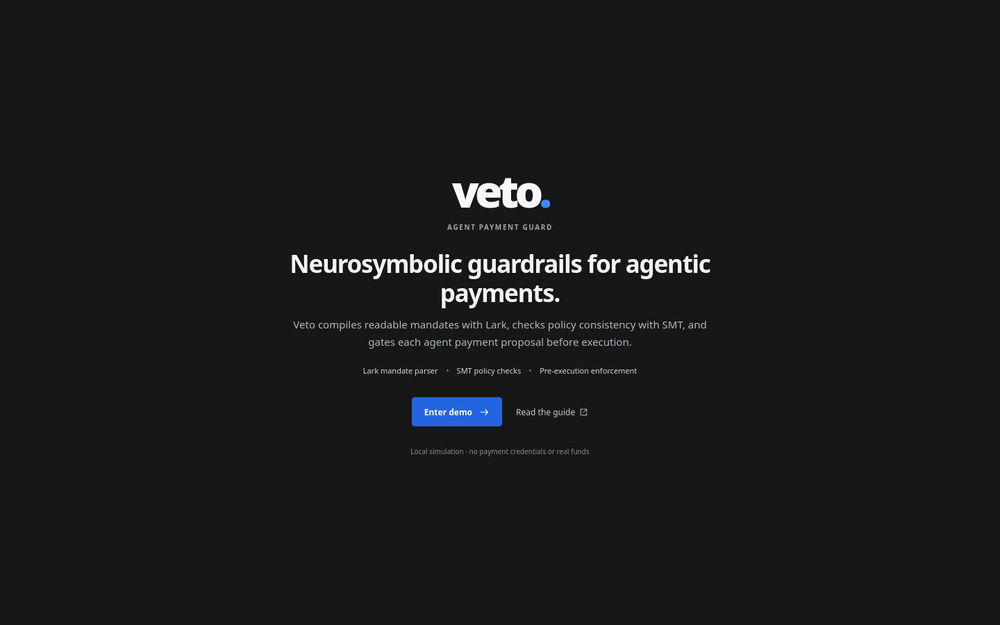
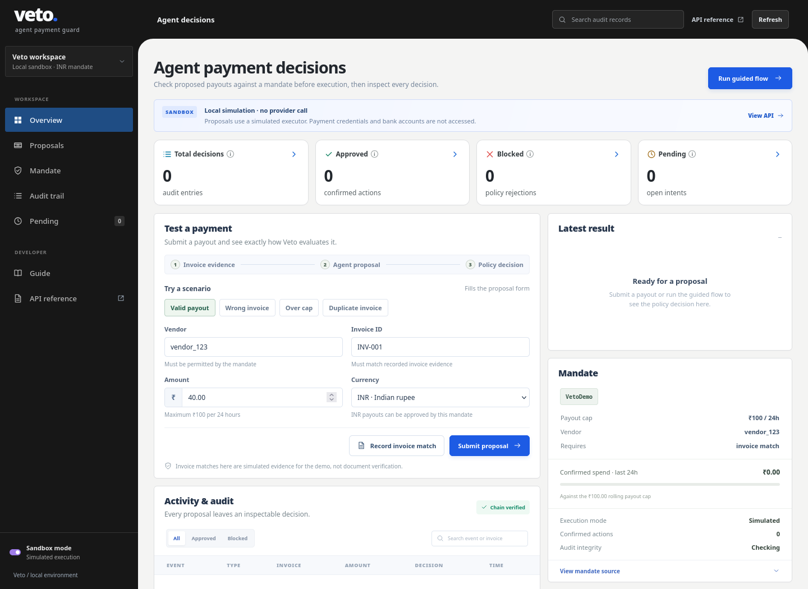
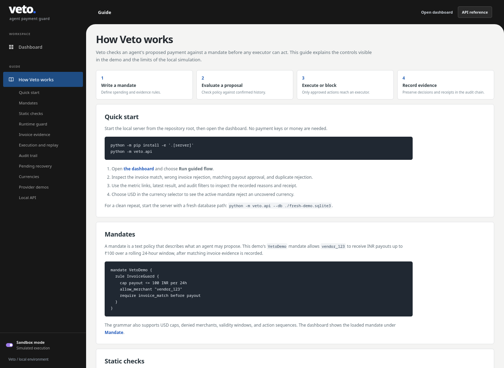

# Veto


Veto is a policy guard for agentic payments. It checks an agent's proposed
payment against a readable mandate before an executor can act, then records
the decision and its evidence.

**Neurosymbolic guardrails for agentic payments:** mandates are parsed with
Lark, policy consistency can be checked with SMT, and the runtime guard
enforces the resulting rules against each proposal.

[Open the dashboard](#start-the-simulated-demo) ·
[Read the in-app guide](#in-app-guide) ·
[See how proposals are handled](#how-a-proposal-is-handled) ·
[Explore the API endpoints](#api-endpoints)

## See Veto

The intro screen leads into a local simulation. The dashboard exposes the
proposal flow, active mandate, audit history, pending intents, and rolling
INR cap usage. The Guide page documents each feature and links to relevant
dashboard views.



The intro explains the product and enters the simulated workspace without
provider credentials.



The dashboard shows live policy decisions, mandate details, audit history,
and the recovery queue from one local SQLite database.



The Guide is a separate page with a sidebar index for each major feature.

## What Veto does

- **Checks mandates before execution.** Rules cover spending caps, merchant
  allowlists and denylists, validity windows, invoice preconditions, and action
  order.
- **Combines symbolic policy with constraint checks.** Lark parses mandate
  text into typed rules. Fast static checks catch common mistakes; optional
  Z3 checks policy action-order cycles.
- **Keeps execution accountable.** The pipeline records an approved intent
  before calling an executor, uses a stable idempotency key, and adds an action
  to confirmed history only after a confirmed receipt.
- **Preserves decision evidence.** Approved, rejected, and failed decisions
  enter a SHA-256 hash-chained SQLite audit log. Uncertain outcomes remain
  pending for reconciliation.

## Start the simulated demo

```bash
python -m pip install -e '.[server]'
python -m veto.api
```

Open [http://127.0.0.1:8000](http://127.0.0.1:8000), choose **Enter demo**,
and run the guided flow. The browser dashboard uses simulated execution only;
it needs no provider keys and does not move real money. Use a separate
database for a clean walkthrough:

```bash
python -m veto.api --db ./fresh-demo.sqlite3
```

### In-app guide

Open [http://127.0.0.1:8000/guide](http://127.0.0.1:8000/guide) for an indexed
walkthrough of mandates, static checks, runtime enforcement, invoice evidence,
execution and replay, audit integrity, pending recovery, currencies, provider
demos, and the local API.

## How a proposal is handled

```text
mandate text -> Lark parser -> static checks -> typed policy
                                             |
agent proposal -> VetoGate -> simulated or test executor -> receipt
                     |                               |
                     +-> rejection audit             +-> confirmed history
                     +-------------------------------+-> hash-chained audit
```

## Current state

The repository includes the Python policy package, mandate grammar, examples,
static and SMT checks, VetoGate, SQLite confirmed history, pending recovery,
the payment pipeline, a simulated dashboard/API, and test-mode adapters for
RazorpayX payouts, Razorpay Payments refunds, and Modern Treasury payouts.
Provider adapters have mocked HTTP tests; the browser dashboard remains a
local simulation.

## Mandate syntax

```text
mandate VendorPayments {
  rule R1 {
    cap payout <= 50000 INR per 24h
    allow_merchant "vendor_123"
    valid_window 2026-01-01T00:00:00Z to 2035-01-01T00:00:00Z
  }
  rule R2 {
    require invoice_match before payout
    sequence [invoice_match, payout]
  }
}
```

The grammar also supports `deny_merchant`, `payment` and `refund` actions,
`USD` caps, and window units `s`, `m`, `h`, `d`, and `w`. Timestamps must carry
an explicit UTC offset. See [the grammar](src/veto/mandate.lark) for the exact
syntax.

## Example mandates

[Vendor payments](examples/vendor_payments.mdt) is the basic policy;
[strict treasury](examples/strict_treasury.mdt) adds a validity window and
action order for the planned demo. The files prefixed `flawed_` in
[examples/](examples/) each show a specific mistake. The bare timestamp file
is a syntax error; the precondition cycle and sequence conflict are found by
Z3. The other flawed examples produce fast static diagnostics.

To parse a mandate after installation:

```bash
python -c 'from veto.mandate_parser import parse_mandate_file; print(parse_mandate_file("examples/vendor_payments.mdt"))'
```

Syntax errors include the file, line, column, and a pointer to the problem.
Parsing alone does not decide whether the mandate's rules are valid.

To load a typed policy:

```bash
python -c 'from veto.policy_loader import load_policy_file; print(load_policy_file("examples/strict_treasury.mdt"))'
```

The loader rejects invalid calendar dates, fractions of a cent, and time
windows that cannot be represented as whole seconds. It keeps potential
conflicts such as duplicate rule ids and inverted validity windows for the
static checks to diagnose.

The [static checks](src/veto/policy_checks.py) now report duplicate rule ids,
merchant allow/deny conflicts and disjoint allowlists during overlapping
validity windows, inverted windows, repeated or shadowed caps with the same
scope, self-preconditions, and repeated sequence steps. All rules apply
together, so their merchant allowlists intersect. A zero cap produces a
warning. To inspect one:

```bash
python -c 'from veto.policy_loader import load_policy_file; from veto.policy_checks import check_policy; print(*check_policy(load_policy_file("examples/flawed_shadowed_caps.mdt")), sep="\n")'
```

The optional [Z3 check](src/veto/z3_checks.py) combines preconditions and
sequences from rules that are valid at the same time. It reports action-order
cycles that prevent completing the involved actions; it does not claim that
every action in the mandate is impossible. Run both tiers with:

```bash
python -c 'from veto.policy_loader import load_policy_file; from veto.z3_checks import verify_policy; print(*verify_policy(load_policy_file("examples/flawed_precondition_cycle.mdt")), sep="\n")'
```

Install the `smt` extra for this check. Without Z3, policies with action-order
rules receive a `z3_unavailable` warning instead of silently skipping it.

## VetoGate

The [runtime gate](src/veto/vetogate.py) checks merchant allowlists and
denylists, per-action and rolling-window caps, validity windows, historical
preconditions, and sequence order. A money-moving action without a matching
cap is rejected. The gate requires a trusted current time and a complete list
of confirmed earlier actions. It returns a verdict but does not execute a
payout or record an approved action yet.

```python
from datetime import datetime, timezone
from veto.models import PaymentAction
from veto.policy_loader import load_policy_file
from veto.vetogate import VetoGate

gate = VetoGate(load_policy_file("examples/basic_payouts.mdt"))
action = PaymentAction(type="payout", amount="40.00", currency="INR", merchant="vendor_123")
verdict = gate.evaluate(action, now=datetime.now(timezone.utc), executed=())
print(verdict)
```

Prior actions satisfy preconditions and sequence steps only for the same
merchant and currency. A sequence governs its first ordered pass; after that,
other policy checks continue to apply. For policies requiring `invoice_match`
before `payout`, a payout must also carry an `invoice_id` matching a confirmed
`invoice_match` for that merchant and currency. The same invoice ID cannot
authorize a second confirmed payout. The demo supplies simulated invoice
evidence; Veto does not yet verify invoice documents or amounts from a trusted
source.

## Confirmed action history

The [SQLite history store](src/veto/state.py) keeps only confirmed actions.
Pass `store.confirmed()` to VetoGate for each proposal. Once an external
executor confirms success, call `store.record_confirmed(event_id, executed)`
with its stable event id and an `ExecutedAction` stamped by trusted code.
Repeating the same event id and content is idempotent; reusing the id for a
different action fails.

Approval alone must not be recorded as execution. The pipeline records an
action here only after its executor returns a confirmed receipt.

## Audit trail

The [audit log](src/veto/audit.py) stores approved, rejected, and execution
error decisions in a separate SQLite table. Each entry includes the action,
reason, time, and a fingerprint of the policy used. Its hash covers the
previous hash and canonical entry content. `verify_chain()` reports the first
broken sequence number, and appending to a broken chain fails. The history
and audit tables can share one database file.

This is tamper-evident against local edits or deletion of entries. Someone
who can rewrite the whole database and recompute the hashes could forge a new
chain; external anchoring or signatures would be needed to resist that.
The pipeline writes its decisions to this log. A confirmed action and its
approved audit entry commit in the same local SQLite transaction.

## Payment pipeline

The [pipeline](src/veto/pipeline.py) checks a proposal against confirmed
history, saves an approved pending intent, calls a supplied executor, then
records the result. The intent is committed before the external call. The
executor receives a stable idempotency key derived from the
policy and event id. Replaying an already recorded event returns its original
result without calling the executor again. Rejections and definite execution
failures receive audit entries but never enter confirmed history. Definite
failures clear the pending intent; uncertain outcomes leave it for recovery.

The current demo uses a simulated executor. No payment provider or credentials
are needed. The executor must honor the idempotency key and return a receipt
only when execution is confirmed. A timeout, queued receipt,
or other uncertain outcome raises `ExecutionUncertainError` and does not enter
confirmed history. Resolve that event with the provider before making another
payment; retrying it requires the same event id and an idempotent executor.

The local database transaction serializes pipeline calls and commits confirmed
history with the audit record. A pending intent blocks new actions until the
same event is retried or reconciled. If the process stops after a provider
succeeds but before the local commit, the intent survives and can be checked
against the provider. Veto still cannot roll back external effects or claim
production-safe live-money recovery. Automatic provider reconciliation,
multi-worker coordination, and trusted invoice verification remain future work.

## Run the simulated demo

After installing the package, run:

```bash
python -m veto.demo
```

The command proposes a 40 INR payout that passes a 100 INR cap, then a 150 INR
payout that the policy rejects. It prints both decisions, the simulated
receipt, the confirmed action count, and the audit chain status. It uses a
temporary SQLite database and deletes it when the command ends. To keep the
database for inspection, supply a path:

```bash
python -m veto.demo --db ./veto-demo.sqlite3
```

Running the command again with that same database replays the two recorded
event ids; it does not create another payout or audit entry. The executor
returns deterministic fake receipts and makes no network calls.

### Run the invoice binding demo

```bash
python -m veto.invoice_demo
```

This simulated walkthrough confirms `INV-001`, rejects a payout for `INV-002`,
approves one payout for `INV-001`, then rejects a second payout for that same
invoice. It needs no keys or money. Pass `--db ./invoice-demo.sqlite3` to keep
the audit and confirmed history; rerunning with the same database replays all
four decisions.

### Run the local dashboard and demo API

Install the `server` extra, then start the API from the repository root:

```bash
python -m pip install -e '.[server]'
python -m veto.api
```

Open `http://127.0.0.1:8000/` for the dashboard. It has a guided flow that
records simulated invoice evidence, blocks a wrong invoice, approves a matching
payout, and blocks a duplicate. Use the proposal form for your own scenarios;
the audit table, policy view, and pending list read from the same SQLite data.
The workspace menu shows the active mandate and local storage. The currency
selector accepts INR and USD so you can inspect the boundary: this demo mandate
can approve INR payouts, while a USD payout is rejected because it has no USD cap.
The separate `/guide` page has a sidebar index for the mandate, static checks,
runtime guard, invoice evidence, execution path, audit chain, pending recovery,
currency behavior, and separate provider demos.
The API reference remains at `http://127.0.0.1:8000/docs`.

The server binds to your machine's loopback address, uses simulated execution
only, and never loads payment-provider credentials. Its default SQLite database is
`data/veto-api-demo.sqlite3`; pass `--db ./another-demo.sqlite3` for an isolated
run.

#### API endpoints

The local API exposes:

| Endpoint | Purpose |
| --- | --- |
| `GET /api/status` | Show mode, counts, and audit integrity |
| `GET /api/policy` | Show the fixed demo mandate |
| `POST /api/demo/invoice-matches` | Record simulated invoice evidence |
| `POST /api/proposals` | Evaluate a payout through the real pipeline |
| `GET /api/audit` | Inspect recorded decisions |
| `GET /api/pending` | Inspect unresolved local intents |

The invoice endpoint accepts `{"event_id":"invoice-1","invoice_id":"INV-001"}`.
The proposal endpoint accepts:

```json
{
  "event_id": "payout-1",
  "action": {
    "type": "payout",
    "amount": "40.00",
    "currency": "INR",
    "merchant": "vendor_123",
    "invoice_id": "INV-001"
  }
}
```

Use a fresh event ID for a different proposal. This local API has no user
authentication and is intended for the demo, not a public deployment.

## RazorpayX test adapter

The [RazorpayX executor](src/veto/razorpayx.py) can be supplied to the payment
pipeline for INR payouts. It requires a test Key ID and secret, a test customer
identifier, and a trusted mapping from merchant labels to pre-created test
fund account ids. It refuses live key ids, never takes a fund account from an
agent proposal, and sends the pipeline's stable idempotency key in RazorpayX's
required `X-Payout-Idempotency` header. Only a matching `processed` response
becomes confirmed history. Queued, pending, processing, failed, or unclear
responses require reconciliation; they are never recorded as completed.

This checkpoint tests the adapter with mocked HTTP responses and does not
make a real RazorpayX API call. Before a test-mode API run, create a test
contact and fund account, allowlist the calling IP, and keep test credentials
outside the repository. Keep the merchant-to-fund-account mapping stable for
retries of the same event. See Razorpay's [payout API](https://razorpay.com/docs/api/x/payouts),
[idempotency guide](https://razorpay.com/docs/api/x/payout-idempotency), and
[test key instructions](https://razorpay.com/docs/x/dashboard/api-keys).

The current action model has a merchant label but no verified beneficiary
identity. This adapter is for test mode only. Binding a beneficiary to a
specific mandate and recovering incomplete provider calls are required before
live use.

## Razorpay Payments test refunds

The [refund executor](src/veto/razorpay_refunds.py) connects approved INR
`refund` actions to Razorpay Payments test mode. It needs a captured test
payment (`pay_...`) made with the same test account, a test Key ID and secret,
and a trusted mapping from each merchant label to its payment ID. Each refund
proposal includes that payment ID; the executor checks it against the trusted
mapping before sending a request. It rejects live Key IDs, uses paise and a
stable `X-Refund-Idempotency` key, and records only matching `processed`
responses. A pending or unclear outcome requires reconciliation before retrying
with the same event ID and request.

The adapter tests use a local mock transport and do not call Razorpay. The
test-mode demo needs a captured test payment before an actual refund.
Razorpay Payments refunds return funds to the original payment
method; this is a separate demonstration from vendor payouts. See the
[normal refund API](https://razorpay.com/docs/api/refunds/create-normal/) and
[test payment guide](https://razorpay.com/docs/payments/payments/test-card-details/).

### Run the test refund demo

From the repository root, preview a 1 INR refund with no credentials or API
call. The demo mandate caps `demo_customer` refunds at 10 INR per action and
per 24 hours:

```bash
python -m veto.razorpay_refund_demo
python -m veto.razorpay_refund_demo --amount 11.00
```

For an actual test-mode refund, make a payment through Razorpay Checkout with
test keys and a [test card](https://razorpay.com/docs/payments/payments/test-card-details/).
Confirm that the payment is **captured** in the test dashboard and copy its
`pay_...` ID. The refund amount must be no more than the unrefunded amount of
that payment. Copy `.env.example` to `.env` in the repository root if you have
not already done so, then fill in:

| Variable | Value |
| --- | --- |
| `RAZORPAY_TEST_KEY_ID` | Payments test Key ID, starting `rzp_test_` |
| `RAZORPAY_TEST_KEY_SECRET` | Matching Payments test Key Secret |
| `RAZORPAY_TEST_PAYMENT_ID` | Captured test payment ID, starting `pay_` |

The `.env` file is ignored by git. The command reads it only when you pass
`--execute`:

```bash
python -m veto.razorpay_refund_demo --execute
```

The default database is `data/razorpay-refund-demo.sqlite3`, and the default
event ID is `razorpay-refund-demo-001`. Keep both the event ID and payment ID
stable when retrying an uncertain refund. Check the refund in Razorpay first;
then rerun the same command. Use a new event ID only for a genuinely new refund.

## Modern Treasury sandbox payout path

The [sandbox executor](src/veto/modern_treasury.py) connects approved USD
`payout` actions to outbound ACH payment orders. It authenticates with the
sandbox Organization ID and API key, checks the key's `live_mode` value before
creating an order, and uses a trusted mapping from merchant labels to sandbox
counterparty external account IDs. It also needs a sandbox internal account ID
as the payout source. Before creating an order, it checks that the configured
recipient ID names a linked sandbox External Account. A live key or unmapped
merchant cannot initiate a payout.

The executor uses both a stable `Idempotency-Key` and a stable `external_id`.
It looks up an existing order before creating one and records only a matching
order with `status=completed`. An `approved`, `sent`, `failed`, or unclear order
requires reconciliation and leaves confirmed history unchanged. Modern
Treasury retains idempotency results for 24 hours; the external ID protects
against creating a second order after that window. A completed ACH can still
be returned later, so the demo can check its status without submitting another
order. Webhook-driven reconciliation remains future work.

The adapter tests use mocked HTTP and do not contact Modern Treasury. Keep
credentials in local environment variables or an ignored `.env` file, never
in tracked files.
See the [payments quickstart](https://docs.moderntreasury.com/payments/docs/quickstart),
[idempotency guide](https://docs.moderntreasury.com/platform/reference/idempotent-requests),
and [payment order statuses](https://docs.moderntreasury.com/platform/reference/payment-order-object).

### Run the sandbox payout demo

From the repository root, preview the guarded USD payout with no credentials
or API call:

```bash
python -m veto.modern_treasury_demo
```

The demo mandate allows `demo_vendor` payouts up to 10 USD per action and per
24 hours. It defaults to 1 USD and stores history in the ignored
`data/modern-treasury-demo.sqlite3` database. Change the amount to see a
rejection before any provider request:

```bash
python -m veto.modern_treasury_demo --amount 11.00
```

To prepare an actual sandbox run, create `.env` in the repository root and
fill it from the Modern Treasury sandbox:

```bash
cp .env.example .env
```

| Variable | Where to find it |
| --- | --- |
| `MODERN_TREASURY_ORG_ID` | API Keys page, Organization ID |
| `MODERN_TREASURY_API_KEY` | API Keys page, sandbox key |
| `MODERN_TREASURY_INTERNAL_ACCOUNT_ID` | Internal Accounts page, account `id` supporting USD ACH |
| `MODERN_TREASURY_RECIPIENT_ACCOUNT_ID` | Counterparty page, external account `id` |

If the sandbox internal account needs funds, follow the
[quickstart funding step](https://docs.moderntreasury.com/payments/docs/quickstart)
first. Then run the command below only when you intend to create the 1 USD
sandbox payment order:

```bash
python -m veto.modern_treasury_demo --execute
```

The command checks that the API key is for the sandbox before creating an
order. It retains the database and event ID across runs. An order may start as
`approved` and complete later. If the result is `UNCERTAIN`, check the order
without creating another one:

```bash
python -m veto.modern_treasury_demo --reconcile
```

To inspect unresolved local intents without keys or network access:

```bash
python -m veto.modern_treasury_demo --pending
```

Keep the same `--event-id`, `--amount`, database, and account mapping as the
original execution. Reconciliation makes only GET requests and records a
matching completed order in confirmed history and the audit log. A pending
order remains unconfirmed and its intent stays visible through `--pending`.
A successful replay reads the local receipt
without another provider request. Use a new `--event-id` only for a separate
sandbox payout after reconciliation.

## Policy and action data

The [validated models](src/veto/models.py) represent spending caps, policy
rules, and proposed actions. Money amounts use decimal values and reject
fractions of a cent. Policy dates require a timezone offset. An agent's action
does not carry a timestamp; the runtime guard uses a trusted clock when it
checks validity windows.

## Set up the development environment

Use Python 3.11 or newer. From the repository root:

```bash
python -m venv .venv
source .venv/bin/activate
python -m pip install -e '.[dev,smt,server]'
python -c 'import veto; print(veto.__file__)'
```

The `smt` extra provides Z3 for policy checks, `server` provides the local
dashboard and API, and `dev` provides pytest. These extras are installed during
development;
the core package can also be installed with `python -m pip install -e .`.

Run the current test suite with `python -m pytest -q`. GitHub Actions runs it
on pushes and pull requests using Python 3.11 and 3.14. The workflow installs
the core package with the `dev` and `smt` extras; later stages will extend it
when other optional components need their own tests.

## Planned boundaries

- The agent proposes actions; it does not decide whether they satisfy policy.
- The runtime guard checks each action before the payout adapter runs.
- The default demo uses simulated payouts. RazorpayX test mode will use test
  credentials; live payouts are outside the demo scope.
- Decisions and execution results will be recorded for inspection.

## License

MIT. See [LICENSE](LICENSE).
